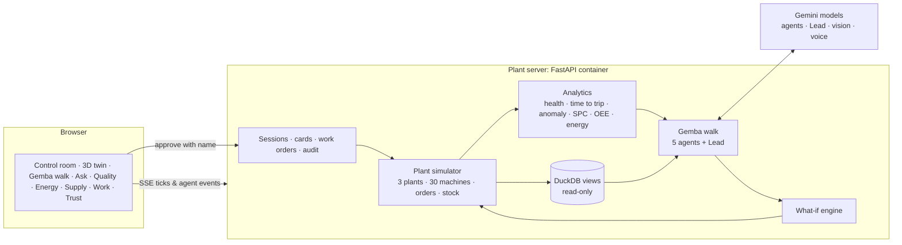

# Gemba — an AI operations floor for manufacturers

> **Gemba (現場)** is the lean-manufacturing word for "the real place": the shop floor. Toyota managers *go to the
> gemba* to see problems with their own eyes. **Gemba sends a team of Gemini agents on that walk**, finds the problems
> that cross departments, and hands the plant team **one plan a named person approves**.

Built for the **AI Builder Cup 2026** (theme: *Manufacturing: Intelligent Operations & Industrial Efficiency*) by team
Aidhunik India (Paras Lehana, Abhinav Kaushik). All data is synthetic; the company, plants, customers and suppliers are
fictional. Money is shown in US dollars.

**Live:** https://gemba.lehana.in (mirror https://gemba.aidhunik.com) · **Demo video:** https://gemba.aidhunik.com/demo
([YouTube](https://youtu.be/RKwNTZ16CIc)) · **How it works:** [docs/HOW-IT-WORKS.md](docs/HOW-IT-WORKS.md) ·
**Architecture:** [docs/ARCHITECTURE.md](docs/ARCHITECTURE.md)

## What it does

| The theme asks for | Gemba agent | Example from the demo plant |
|---|---|---|
| reliability | **Reliability** | VMC-204's spindle bearing is wearing: vibration 3.9 mm/s and rising at steady speed, trip limit in about 2–3 days, preventive maintenance 12 days overdue, no spare in Pune |
| quality | **Quality** | Chatter-mark scrap on VMC-204 at 4.4× its normal (confirmed by **Gemini vision** on a part photo); porosity on the Rayong casting cells traced to lot AL-2210 |
| supply & demand | **Supply** | Order SO-24117 (4,100 cylinder heads, raised from 3,500) is short if nothing is done; Chakan has two bearings, 9 h away |
| sustainability | **Energy** | VMC-204 uses 25 % more kWh per good part; compressor CMP-901 draws 11.6 kW extra at night (an air leak: about $9k of electricity a year) |
| efficiency | **Flow** | Cylinder Head Line OEE fell from 72 % to 69 %; a 4 h planned repair recovers 32 machine-hours of downtime |

A **Gemba Lead** agent links the findings (the quality problem *is* the machine problem), tests options on the plant
simulator ("repair now or in tonight's off-peak window?") and writes **plan cards**. Each card shows do-nothing vs
with-this-card for good parts, scrap, downtime, kWh per part, CO2e and money — **computed by the simulator, not by the
language model**. A person types their name and approves; work orders appear; the technician follows lock-out steps on
the phone and asks questions **by voice in Hindi, Marathi, Thai or English**.

## What makes it different

- **Gemba Watch:** agents act on events, not only on request. When a new signal appears (a machine starts to wear, a
  sensor freezes, a compressor starts to leak), only the agents that signal needs start, and new cards arrive.
- **Time travel on the digital twin:** scrub three days back or three days ahead, with the approved plan or if nothing
  is done; watch VMC-204 trip, or get repaired.
- **People stay in charge:** retime any card and the simulator recomputes its impact before you approve; a repair
  cannot start before its spare part arrives; approvals, edits and rejections are remembered and given to the Lead on
  the next walk ("What Gemba learned").
- **Honest under failure:** if Gemini is unreachable, the UI says so and offers a clearly labelled rules engine or a
  replay of a recorded live Gemini walk (numbers recomputed on the current plant).

## New in 0.4: built for people who are new to factories

- **Learn mode and tutor:** every technical word (spindle, chatter marks, OEE, kWh per good part…) has a plain-language
  explanation; "Explain this" asks a Gemini tutor in simple words; a five-minute lesson with small interactive examples.
- **Drills:** start a realistic fault in 30 seconds (bearing wear, air leak, frozen sensor), run the plant at 10× or 60×,
  and watch Gemba Watch notice it, call the agents and post cards; browser alerts before the agents start.
- **3D drill-down:** from company → plant → line → machine → assembly → component → sensor, with an exploded,
  cut-away CAD-style view of a machining centre that shows which bearing is wearing and which sensor sees it.
- **Every card explained:** a detail page per card with the evidence, what each action means, who does it, the timeline,
  and why each number goes up or down when you retime it.
- **Live readings like a ticker:** values update on the twin and on every machine page; "What does waiting cost?"
  compares repairing now with later in production, labour and money.

## Where Gemini does the work

- **Five specialist agents + a Lead** with function calling over 18 typed tools (plant data, maintenance history,
  spares, SQL, what-if simulation), streamed live to the browser; structured findings and plans via tool schemas.
- **Gemini vision** inspects part photos and returns the defect class, boxes (`box_2d`) and likely cause.
- **Ask Gemba**: natural language → DuckDB SQL over the plant (read-only, guarded), with a chart; the SQL is one click away.
- **Tutor**: explains any term or number in simple words for beginners, with an everyday example.
- **Voice assistant** for technicians, answering from the job card and live machine data in the worker's language.
- **Sample part photos** were generated by the team with a Gemini image model (`tools/make_sample_images.py`).

Classical maths is used where it beats language: wear-curve extrapolation with a bootstrap range, an IsolationForest
anomaly model, p-charts, OEE, Holt forecasting and a physics-style plant simulator.

## Guardrails

Agents propose, people approve (with a name, recorded) · numbers come from tools, not the model · a frozen sensor never
sends a repair crew (repairs are converted to sensor checks) · repairs wait for the spare part · read-only SQL with
external access off · release needs a vibration reading ≤ 2.3 mm/s after lock-out · non-Gemini model replies are
rejected · every step is in the audit log.

## Architecture



The simulator stands in for the edge connectivity layer of Google's manufacturing reference pattern (edge → data
platform → Gemini agents); the same tools would read a historian, an ERP export or BigQuery in a real plant.

## Run it

```bash
python3 -m venv .venv && .venv/bin/pip install -r requirements.txt
GEMBA_LLM=mock .venv/bin/uvicorn app.main:app --port 8411        # rules engine, no model
GEMINI_API_KEY=... .venv/bin/uvicorn app.main:app --port 8411    # Gemini API
.venv/bin/python -m pytest -q                                      # 20 tests
```

Live: **https://gemba.lehana.in**. Deployment options (own server, Firebase Hosting front end, Cloud Run):
[`docs/DEPLOY.md`](docs/DEPLOY.md). Presenter controls (⏱ in the header) move the plant clock,
inject faults (bearing wear, air leak, stuck sensor) and reset the story.

## Repository map

| Path | What |
|---|---|
| `app/sim/` | Plant catalog, physics-style simulator, ERP and maintenance records |
| `app/analytics/` | Condition, anomaly, quality, energy, OEE, snapshot, what-if |
| `app/agents/` | Gemini client, tools, Gemba walk, Ask, vision, voice |
| `app/data/views.py` | DuckDB views and the SQL guard |
| `app/store/` | Sessions, work orders, rate limits |
| `static/` | The web app (ES modules, Three.js, SVG charts; no build step) |
| `tests/` | Unit and API tests; `tests/browser/routes.py` browser sweep |
