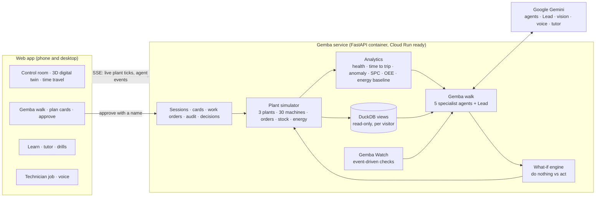

# Architecture

Gemba is one container: a FastAPI service that runs the plant simulator, the analytics, the Gemini agents and two live
streams, and serves the web app (vanilla ES modules, Three.js, hand-written SVG charts; no build step).

## Key design decisions

| Decision | Why |
|---|---|
| The simulator is a pure function of time plus each visitor's interventions | The same code answers "now", "three days ago" (history, time travel) and "Friday if we wait" (what-if); every visitor gets a private, reproducible plant |
| Numbers on cards come from the simulator, not the model | Gemini decides *what* to do; the simulator computes *what it changes* (good parts, scrap, downtime, energy, CO2e, money, order cover) |
| Agents call typed tools and finish with a schema (`submit_finding`, `submit_plan`) | Structured output that the server validates; a labelled rules engine takes over when the model is unreachable |
| Read-only SQL on a private DuckDB copy | Ask Gemba can write SQL safely: one SELECT, file and network access off, 200-row cap, 3 s timeout |
| Server-Sent Events | One-way live streams (plant ticks, agent events) are all the UI needs, and they work through proxies |
| One container | Deploys to Cloud Run as is; a Firebase Hosting front end bundle is included |

## Data

Fully synthetic: the fictional Meridian Precision Components (Pune and Chakan in India, Rayong in Thailand), about 30
machines on 8 lines, sensors, shifts, wear physics, scrap by defect, energy with time-of-day tariffs and grid carbon
factors, customer orders, stock and maintenance history. Part photos were generated by the team with a Gemini image
model. Money is shown in US dollars.
